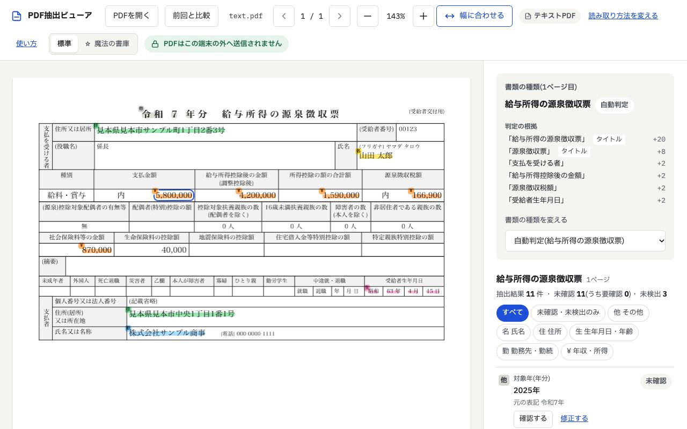

# browser-pdf-highlighter(PDF抽出ビューア)

不動産取引(賃貸の入居審査・住宅ローン審査)で受け取る書類のPDFから、氏名・住所・生年月日・勤務先・年収などの項目を取り出し、
PDFの上の該当箇所にハイライトを付けるWebアプリです。前回受け取った資料と比べて、違うところも確かめられます。

**PDFはブラウザの中だけで処理し、どこにも送信しません。** 抽出はルール(正規表現と、文字の位置関係)で行い、AIのサービスは使いません。



## できること

- **項目の抽出とハイライト**: 書類の種類を自動で判定し、項目を一覧にします。PDFの上では、項目の種類ごとに色分けした蛍光ペンのようなハイライトを付けます
- **確認と修正**: 取り出した値を1つずつ「確認済み」にしたり、書き直したりできます。見つからなかった値は、PDFの上で範囲を選んで入れられます
- **スキャンしたPDFの OCR**: 画像だけのPDFは、ブラウザの中で文字を読み取ります(tesseract.js)。勤務先から電子で受け取った源泉徴収票のような、様式が画像で値だけが文字のPDFにも対応しています
- **前回の資料との比較**: 前回のPDF、または前回保存した抽出結果(JSON)と比べ、項目ごとの違いと、文章の行ごとの違いを示します
- **保存・印刷**: 確認・修正した結果をJSONで書き出し、一覧を印刷できます。元のPDFにハイライトを注釈として書き込んだPDF(コメントに項目名と値)も保存できます
- **使い方のページ**: 画面のヘッダーの「使い方」から、スクリーンショット付きの説明を開けます([src/help/HelpPage.tsx](src/help/HelpPage.tsx))
- **テーマの切り替え**: 標準と、古書の雰囲気の「魔法の書庫」を切り替えられます

### 対応している書類

| 書類 | 主な項目 |
|---|---|
| 給与所得の源泉徴収票 | 対象年・氏名・住所・生年月日・勤務先・支払金額(年収)・給与所得控除後の金額・源泉徴収税額 など |
| 課税証明書・所得証明書 | 年度・氏名・住所・生年月日・給与収入・合計所得金額・年税額 など |
| 住民税決定通知書 | 年度・氏名・住所・勤務先・給与収入・合計所得金額・年税額 など |
| 確定申告書(第一表) | 対象年・氏名・住所・職業・事業収入・所得金額の合計・申告納税額 など |
| 住宅ローン申込書 | 氏名・現住所・勤務先・勤続年数・年収・他の借入・借入希望額・物件 など |
| 入居申込書(賃貸) | 物件・賃料・申込者と連帯保証人の氏名・勤務先・年収 など |

抽出する項目の一覧と、差分の判定ルール・出力形式は [docs/extraction-fields.md](docs/extraction-fields.md) にあります。

## 使い方

1. 画面の「PDFを開く」を押すか、PDFを画面にドラッグします
2. 右側の一覧で、取り出した値をPDFと見比べて確認します。違う値は「修正する」で書き直します
3. 前回の資料と比べるときは「前回と比較」で、前回のPDFか、前回「JSONで保存」したファイルを選びます

詳しくは、アプリの「使い方」のページを見てください。

## しくみ

```
PDF ─ pdf.js ─┬─ 文字が入っているページ ──────────────┐
              └─ 画像だけのページ ─ OCR(tesseract.js) ─┴─ 書類の種類の判定 ─ 書類定義(ルール)で抽出 ─ 確認・修正 ─ 比較
```

| ディレクトリ | 内容 |
|---|---|
| `src/pdf/` | PDFの読み込み、ページの種類(テキスト・スキャン・透明テキスト付き・様式が画像 など)の判別 |
| `src/ocr/` | OCR の前処理(2値化・傾きの補正・罫線の除去)と、tesseract.js での読み取り |
| `src/classify/` | 書類の種類の判定 |
| `src/extract/` | 抽出エンジンと、書類ごとの書類定義(`definitions/`)。書き方は [docs/extraction-rules.md](docs/extraction-rules.md) |
| `src/results/` | 抽出結果の一覧、確認・修正、JSONの書き出しと読み込み |
| `src/diff/` | 前回の資料との比較(項目の差分・テキスト差分) |
| `src/highlight/` | PDFの上のハイライト |
| `src/help/` | 使い方のページと、そのスクリーンショット |
| `schema/` | 抽出項目の定義(`extraction-fields.json`) |
| `samples/` | テスト用のダミーPDFと正解データ(実在しない人物・団体) |
| `scripts/` | ダミーPDFの生成、スクリーンショットの撮影、各種チェック |
| `docs/` | 書類の様式の調査、抽出項目、書類定義の書き方、本番環境の構築手順 |

## 開発

Node.js 22.23.4 以上が必要です(2026年10月21日のセキュリティ修正を含む版)。使う版は `.nvmrc` に書いてあり、CI もこの版で動きます。

```bash
npm install
npm run dev          # 開発サーバー(http://localhost:5173)
npm run build        # dist/ に静的ファイルを出力
npm run preview      # ビルド結果をローカルで確認
```

ダミーPDFと、使い方のページのスクリーンショットは、次のコマンドで作り直せます(Google Chrome が必要)。

```bash
npm run samples           # samples/ のダミーPDFと正解データを生成
npm run help:screenshots  # src/help/screenshots/ のスクリーンショットを、ダミーPDFから撮影
```

## チェック

```bash
npm run lint         # Biome による Lint とフォーマットの確認(npm run format で自動修正)
npm run typecheck    # TypeScript の型チェック
npm test             # Vitest によるユニットテスト
npm run check:build  # dist/ が外部のURLから何も読み込まないことの確認(build の後に実行)
npm run check:files  # 実データらしいPDF・画像をリポジトリに入れていないことの確認
npm run samples:check  # ダミーPDFのページの種類と、正解データの形式の確認
npm run test:e2e     # E2Eテスト: 外部への通信がないこと、テーマ・使い方のページの確認(build の後に実行)
```

`npm test` には、ダミーPDFを使ったリグレッションテストも含まれます。仕組みと、実データの扱いのルールは [samples/README.md](samples/README.md) を見てください。

CI(GitHub Actions)では、上のチェックとビルドをすべて実行し、main では Cloudflare Pages にデプロイします。
本番環境の構築手順は [docs/deploy-cloudflare.md](docs/deploy-cloudflare.md) にあります。

## 実データの扱い

- 実在の書類(マスクしたものを含む)は、リポジトリ・テスト・コミット・PRに入れません。手元で試すときは `local-samples/`(`.gitignore` で除外)に置きます
- テストとスクリーンショットには、`samples/` の架空のダミーPDFだけを使います
- `npm run check:files` が、`samples/` の外にあるPDF・画像(スクリーンショットの一覧に載っているものを除く)を見つけると失敗します

## 外部への通信をしない仕組み

- PDF はブラウザの File API で読み込み、どこにも送信しません
- pdf.js の worker と、実行時に読み込むデータファイル(CMap・標準フォント・wasm・ICCプロファイル)は、
  CDN を使わずアプリと同じオリジンから配信します(`vite-plugins/pdfjs-assets.ts`)
- PDF に埋め込まれた JavaScript を実行するためのファイルは配信しません
- スキャンPDFの OCR(tesseract.js)も、ブラウザの中で行います。OCR の worker・文字認識の本体(WebAssembly)・
  日本語の学習データも、CDN を使わずアプリと同じオリジンから配信します(`vite-plugins/tesseract-assets.ts`)
- コンテンツセキュリティポリシー(CSP)で、読み込みと通信をアプリと同じオリジンだけに限っています
  (`vite-plugins/security-headers.ts`)。ビルドした `index.html` に `<meta>` で入れるほか、`npm run preview` の応答と
  Cloudflare Pages 用の `dist/_headers` にもヘッダーで付けます(worker には `<meta>` が効かないため)。
  開発サーバー(`npm run dev`)では付けません
- アナリティクス・外部フォント・CDN は使いません。フォントもアプリに同梱しています
- 抽出した値や読み込んだPDFは、ブラウザの保存領域(localStorage・sessionStorage・IndexedDB)に保存しません。
  画面を閉じると消えます。残したいときは、利用者が「JSONで保存」で自分の端末に書き出します
- 保存領域に残すのは、ヘッダーで選んだ画面のテーマ(標準・魔法の書庫)だけです。魔法の書庫を選んだときだけ
  localStorage の `theme` に保存し、標準に戻すと消します(`src/theme/theme.ts`)
- E2Eテスト(`e2e/network.spec.ts`)で、スキャンPDFの OCR と前回の資料との比較を行い、その間に外部ドメインへの
  リクエストと CSP の違反が1件もないこと、ブラウザの保存領域に何も残っていないことを確かめます

### E2Eテストを手元で動かすとき

インストール済みの Google Chrome を使います(ブラウザのダウンロードは不要)。
Apple Silicon の Mac では、arm64 版の Node.js を使ってください。Intel 版の Node.js から起動すると、Chrome も
Intel 版として Rosetta の変換を通して動くため、OCR に10倍ほどの時間がかかります
(`node -p process.arch` が `arm64` なら問題ありません)。
